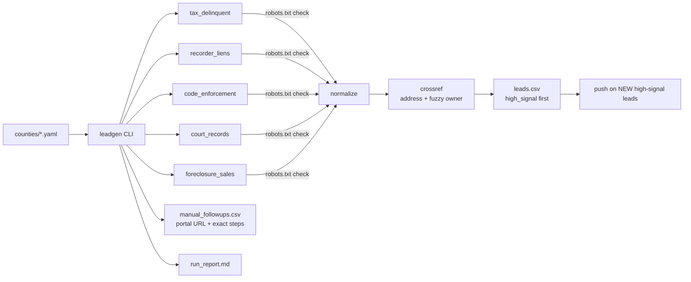

# Case study: Public-Records Lead Pipeline

> Pull, normalize, and cross-reference county public records (tax
> delinquency, liens, code enforcement, court filings, foreclosure sales)
> into a short, high-signal list for review, and be explicit about what
> *can't* be automated.

| | |
|---|---|
| **Stack** | Python · pluggable source adapters · YAML per-county config · robots.txt enforcement · GitHub Actions · Web Push |
| **Status** | Feature branch [`claude/distressed-property-leads-vvm4g3`](https://github.com/alexmrivasjr/alexmrivasjr.github.io/tree/claude/distressed-property-leads-vvm4g3/distressed-property-leads) (unmerged) |
| **Tests** | 27 passing (verified 2026-11-04) |
| **Coverage** | Benton County and Franklin County, WA, plus a template for adding any county |

## Problem

Public records that signal a motivated seller are spread across five
different county offices. Each one publishes differently: a downloadable
file, a search form, a paid portal, or nothing at all. Checking them by hand
is slow, and the useful signal is in the *overlap* (for example, a property
that is both tax-delinquent *and* has a code violation).

## Constraints

- **Legitimate access only.** No scraping search forms and no bypassing
  `robots.txt`. A paywalled portal stays paywalled.
- **Never fabricate data.** A source that can't be automated must say so,
  with instructions for a human, rather than fail silently.
- Every county is different, so per-county behaviour must be **config, not
  code**.

## Architecture

## Key decisions

- **The "manual follow-up" output is a first-class result.** Benton County
  currently has no bulk-downloadable list for any of the five sources, so a
  run there produces **0 automated leads and 10 precise manual tasks**.
  That's the correct answer, and the README says so rather than hiding it.
- **Cross-referencing is the product.** Addresses are normalized (street
  types, unit numbers, directionals) and anything that appears under two or
  more source categories is flagged `high_signal`. A weaker second pass
  fuzzy-matches owner names across different addresses.
- **Unverified assumptions are labelled.** Franklin County's tax-sale URL
  was inferred from search snippets because the dev environment couldn't
  reach the county site. The config and README flag it as **unverified**,
  and the pipeline degrades to a manual follow-up if it's wrong.
- **Notification state is tested.** Only *new* high-signal leads trigger a
  push, so a weekly run doesn't re-alert on the same property.
- **It reuses existing infrastructure.** Push delivery uses the same VAPID
  setup as the deal tracker, so there's no new secret to manage.

## Verification

27 tests: county config schema validation, address normalization, cross-ref
matching, list fetching, robots.txt handling, and notification-state
transitions.

## What I'd do next

- Verify the Franklin County URL from a normal network, then merge.
- Add a per-source "last successfully fetched" timestamp to the run report,
  so a county quietly removing a file gets noticed.
