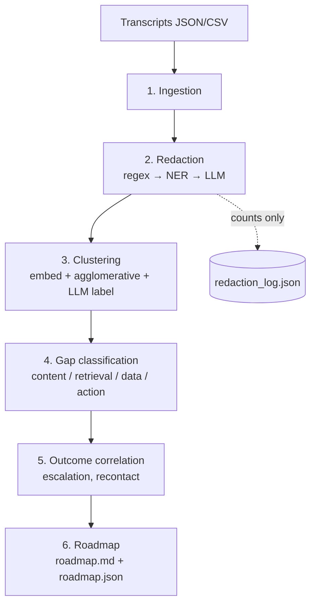

# Case study: Support Conversation Gap Diagnostic

> Turn raw support transcripts into a **volume-weighted build roadmap** of
> what to build (content, data surfacing, or bot actions) so more support
> volume resolves without a human.

| | |
|---|---|
| **Stack** | Python · spaCy + Microsoft Presidio · Claude API (with an offline mock) · scikit-learn clustering · pytest |
| **Status** | v1 complete; real-data backtest pending |
| **Tests** | 30 passing, fully offline (verified 2026-11-04) |
| **Repo** | Private. Built against synthetic data only, so the code and approach can be discussed without exposing customer data. |

## Problem

We had already reached a **70% automated resolution rate** on our own
support volume, but only by building fixes with full access to our codebase
and API docs. The open question was whether useful build recommendations
can come from **conversation text alone**. If they can, the same analysis
works for a team whose code you can't see.

v1 exists to answer that question. The deliverable is the *comparison*
between what the pipeline recommends and what we actually built, not the
pipeline by itself.

## Constraints

- **Transcripts are full of PII.** Redaction has to be provably good and
  has to run *before* anything else, including before any text reaches an
  LLM.
- **No real data in the repo, and CI with no API key.** Every stage must
  run offline and deterministically.
- **Explicit non-goals for v1:** no live connectors, no code generation, no
  literal API endpoints, no dashboard. The output is a spec engineers can
  act on.

## Architecture

Six stages. Each one reads the previous stage's checkpoint file and writes
its own, so any single stage can be rerun or debugged on its own.

## Key decisions

**Layered redaction, cheapest and most deterministic first.**
1. Regex handles structurally recognizable PII: email, phone, SSN, and
   card numbers with a **Luhn check** so random digit strings don't
   false-positive.
2. NER (Presidio + spaCy) handles names, locations, and dates.
3. An LLM contextual pass catches what the first two miss ("my husband
   John's account…"). Entities from layers 1–2 are **masked before the text
   is sent to the LLM**, so this pass never sees PII that's already been
   caught.

Overlapping detections are merged before masking, so two layers that both
flag the same entity don't double-process it.

**`mask` by default, `pseudonymize` only on request.** Pseudonymization keeps
referential integrity (the same email maps to the same token across
conversations), but it's only enabled when something downstream needs that
continuity.

**The redaction log stores counts, never content.** It's safe to share even
when the input is a real client's data.

**Redaction is a standalone module** with its own CLI and README, because
it's the first thing any data owner will want proven out on its own.

**Mock LLM mode.** Every LLM-dependent stage has a deterministic mock, so
the full pipeline runs in CI with no key and no cost. The README says
plainly that mock output reflects *structure*, not accuracy.

**Synthetic data with an answer key.** The generator produces realistic
volume skew (a few high-volume intents and a long tail) and plants PII in
deliberately varied places: clean fields, free text, and messy formats. It
writes a `pii_answer_key.json`, so redaction **recall is measurable** per
placement category.

**Human-in-the-loop validation, on purpose.** The backtest harness doesn't
auto-match roadmap clusters to "things we built", because that's a semantic
judgment that shouldn't be automated before anyone has seen real
comparisons. The script tallies human verdicts instead. Automating the
matching is a v2 candidate *if* a pattern shows up.

## Verification

- 30 pytest tests: the regex layer in isolation, redaction recall against
  the answer key, ingestion edge cases (malformed records, missing fields),
  clustering invariants (each conversation assigned exactly once), the gap
  classifier's fallback on malformed LLM output, outcome rates computed only
  over fields that are present, and an end-to-end smoke test.
- `validation/backtest.py` plus a ground-truth template define how v1 gets
  scored against reality.

## What I'd do next

1. Run the backtest on real, pre-redacted historical transcripts. That's
   the actual v1 deliverable.
2. Track redaction recall per entity type over time as a regression metric
   in CI.
3. Only after several backtests: try semi-automated cluster-to-ground-truth
   matching.
